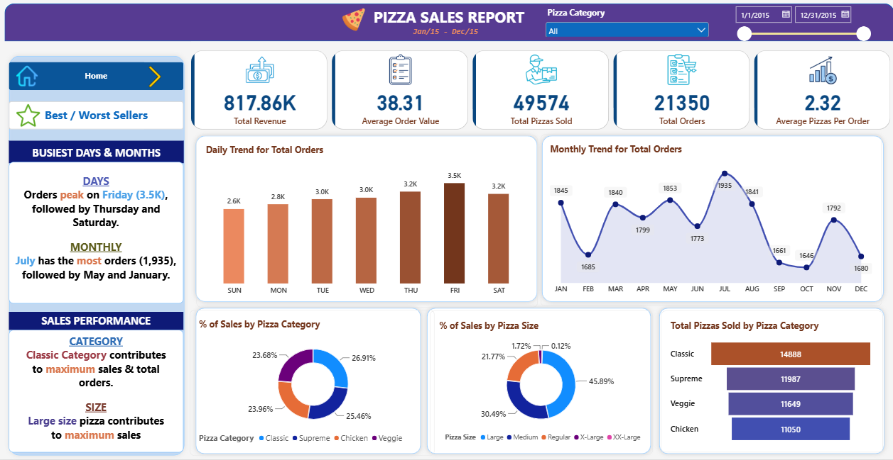
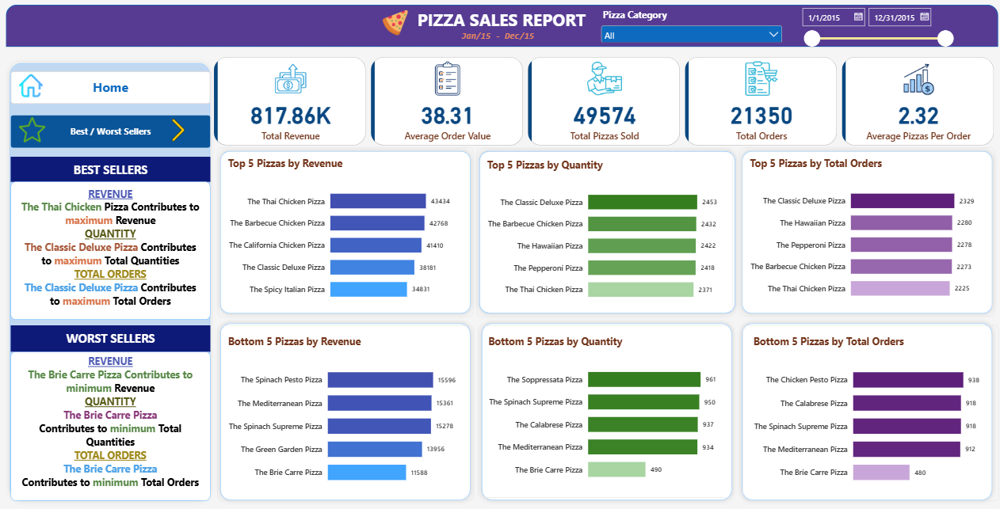

# Pizza Sales Analysis (SQL + Power BI)

An end-to-end analysis of one year (Jan-Dec 2015) of pizza sales data. I used **MySQL** to answer the business questions and built a two-page **Power BI** dashboard to present the results.

## Problem statement

We need to analyze key indicators for our pizza sales data to gain insights into our business performance, and visualize various aspects of the data to understand key trends.

### KPI requirements

Calculate the following metrics:

1. **Total Revenue:** The sum of the total price of all pizza orders.
2. **Average Order Value:** The average amount spent per order, calculated by dividing the total revenue by the total number of orders.
3. **Total Pizzas Sold:** The sum of the quantities of all pizzas sold.
4. **Total Orders:** The total number of orders placed.
5. **Average Pizzas Per Order:** The average number of pizzas sold per order, calculated by dividing the total number of pizzas sold by the total number of orders.

### Charts requirements

1. **Daily Trend for Total Orders:** Create a bar chart that displays the daily trend of total orders over a specific time period. This chart will help us identify any patterns or fluctuations in order volumes on a daily basis.
2. **Monthly Trend for Total Orders:** Create a line chart that illustrates the monthly trend of total orders throughout the year. This chart will allow us to identify peak months or periods of high order activity.
3. **Percentage of Sales by Pizza Category:** Create a pie (donut) chart that shows the distribution of sales across different pizza categories. This chart will provide insights into the popularity of various pizza categories and their contribution to overall sales.
4. **Percentage of Sales by Pizza Size:** Create a pie (donut) chart that represents the percentage of sales attributed to different pizza sizes. This chart will help us understand customer preferences for pizza sizes and their impact on sales.
5. **Total Pizzas Sold by Pizza Category:** Create a funnel chart that presents the total number of pizzas sold for each pizza category. This chart will allow us to compare the sales performance of different pizza categories.
6. **Top 5 Best Sellers by Revenue, Total Quantity and Total Orders:** Create bar charts highlighting the top 5 best-selling pizzas based on revenue, total quantity and total orders. These charts will help us identify the most popular pizza options.
7. **Bottom 5 Worst Sellers by Revenue, Total Quantity and Total Orders:** Create bar charts showcasing the bottom 5 worst-selling pizzas based on revenue, total quantity and total orders. These charts will enable us to identify underperforming or less popular pizza options.

### Scope note

The dashboard covers daily and monthly order trends. An hourly trend analysis is not part of the dashboard; the hourly query is included in the SQL file as extra analysis.

## Tools

- MySQL (data analysis)
- Power BI (dashboard)

## Dataset

`data/pizza_sales.csv` has 48,620 rows covering 21,350 orders from 1 Jan 2015 to 31 Dec 2015. The data is clean: no null values and no duplicate rows.

## KPIs

| KPI | Value |
|---|---|
| Total Revenue | 817.86K |
| Average Order Value | 38.31 |
| Total Pizzas Sold | 49,574 |
| Total Orders | 21,350 |
| Average Pizzas Per Order | 2.32 |

## Key insights

- **Days:** Orders peak on Friday (3,538), followed by Thursday (3,239) and Saturday (3,158). Sunday is the slowest day (2,624).
- **Months:** July has the most orders (1,935), followed by May (1,853) and January (1,845). October is the lowest (1,646).
- **Category:** Classic contributes the most sales (26.91%) and sells the most pizzas (14,888).
- **Size:** Large pizzas contribute the most sales (45.89%).
- **Best sellers:** The Thai Chicken Pizza leads in revenue (43,434). The Classic Deluxe Pizza leads in quantity (2,453) and total orders (2,329).
- **Worst seller:** The Brie Carre Pizza is last in revenue (11,588), quantity (490) and total orders (480).
- **Peak hours (SQL analysis):** Orders peak between 12-2 PM and 5-7 PM. This was found with the hourly query in the SQL file and is not part of the dashboard.

## Dashboard

**Page 1: Home**



**Page 2: Best / Worst Sellers**



## Project structure

```
Pizza-Sales-Dashboard/
├── data/pizza_sales.csv
├── sql/pizza_sales_queries.sql
├── powerbi/pizza_sales_report.pbix
├── images/
│   ├── page1.png
│   └── page2.png
└── README.md
```

## How to run

1. Import `data/pizza_sales.csv` into MySQL as the table `pizza_sales` in a database called `pizza_db`.
2. Run the queries in `sql/pizza_sales_queries.sql`.
3. Open `powerbi/pizza_sales_report.pbix` in Power BI Desktop to explore the dashboard.

## Notes

The insight text boxes in the dashboard are static and describe the full year across all pizza categories. They do not change when the Pizza Category slicer is used.
